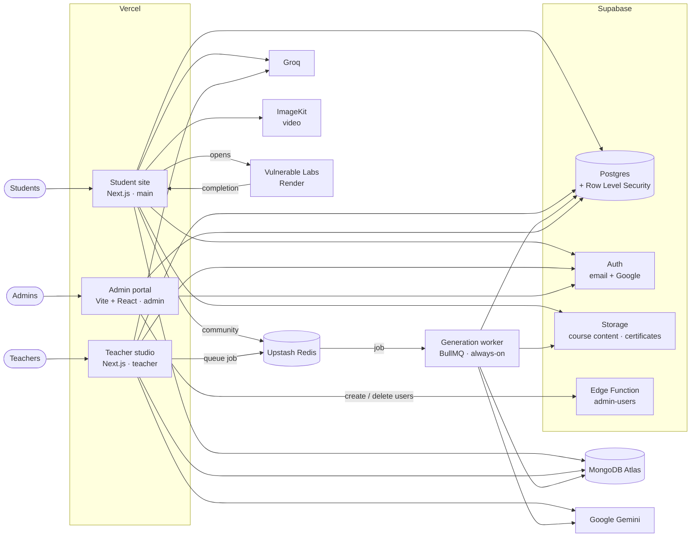
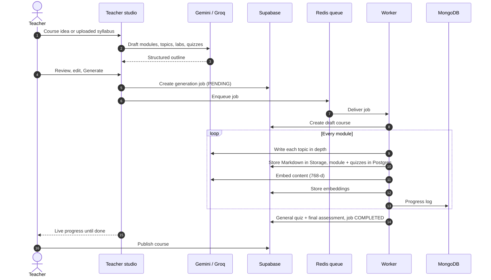

<div align="center">


# GradeU

**Hands-on learning, generated by AI, verified by proctoring.**

GradeU is a learning platform where courses are written by AI from a teacher's outline,
students learn through modules, live labs and an AI tutor, and every assessment is proctored in the browser.

[**Visit GradeU →**](https://gradeu.sparkstudio.co.in)


</div>

---

## Contents

- [The platform at a glance](#the-platform-at-a-glance)
- [Architecture](#architecture)
- [Student site](#-student-site)
- [Teacher studio](#-teacher-studio)
- [Admin portal](#-admin-portal)
- [How a course gets generated](#how-a-course-gets-generated)
- [AI in GradeU](#ai-in-gradeu)
- [Security model](#security-model)
- [Data model](#data-model)
- [Deployment](#deployment)
- [Repository layout](#repository-layout)
- [The team](#the-team)
- [License](#license)

---

## The platform at a glance

GradeU is three applications sharing one backend. Each lives on its own branch of this repository and deploys as its own Vercel project.

| App                | Who it's for    | Branch    | Built with                 |
| ------------------ | --------------- | --------- | -------------------------- |
| **Student site**   | Learners        | `main`    | Next.js 16 · React 19      |
| **Teacher studio** | Teachers        | `teacher` | Next.js 16 · BullMQ worker |
| **Admin portal**   | Platform admins | `admin`   | Vite · React 18            |

All three talk to the same **Supabase** project (Postgres, Auth, Storage), so a course a teacher publishes appears for students immediately, and an admin sees both.

---

## Architecture



| Service                      | What GradeU uses it for                                                                                   |
| ---------------------------- | --------------------------------------------------------------------------------------------------------- |
| **Supabase Postgres**        | Users, roles, courses, modules, quizzes, enrollments, progress, certificates, generation jobs, embeddings |
| **Supabase Auth**            | Email/password and Google sign-in for all three apps                                                      |
| **Supabase Storage**         | Generated course content (Markdown), certificate images, teacher signatures, avatars                      |
| **Supabase Edge Function**   | `admin-users`: the only place the service-role key is used on behalf of the admin portal                  |
| **MongoDB Atlas**            | High-volume logs: proctoring events, learning-experience analytics, course-generation logs                |
| **Upstash Redis**            | Community posts (REST API) and the course-generation job queue (BullMQ over TCP)                          |
| **Google Gemini**            | Course content generation and text embeddings                                                             |
| **Groq**                     | The student AI tutor and fast drafting in the teacher studio                                              |
| **ImageKit**                 | Video library hosting and delivery                                                                        |
| **Vulnerable Labs (Render)** | Live, intentionally vulnerable environments for hands-on labs                                             |

---

## 🎓 Student site

The learner-facing app on `main`.

**Learning**

- **Course catalog and course pages:** every published course with its modules, topics, initial assessment and final assessment.
- **Module viewer:** long-form Markdown lessons with diagrams (Mermaid), streamed from Supabase Storage and tracked topic by topic.
- **AI tutor:** a chat panel inside each module that answers questions using the course, module and topic the student is reading as context.
- **Video library:** course videos served through ImageKit, with a Plyr player.

**Practice**

- **17 hands-on labs:** 6 Web Security labs built around the OWASP Top 10, and 11 NLP labs from text basics to embeddings, NER and text generation.
- Labs run on a separate live environment. Completion comes back to GradeU through a `?labCompleted=` redirect, or a server-to-server webhook signed with a shared secret.

**Assessment and proof**

- **Proctored quizzes:** client-side face detection (TensorFlow.js BlazeFace on WebGL) watches for _no face_ and _multiple faces_, and the browser reports _tab switches_, _window blur_, _leaving fullscreen_ and _copy/paste_.
  - Students get **3 warnings**. The third violation terminates the exam and locks it: **3 hours** for exams and final assessments, **1 hour** for anything else.
  - Every event is logged to MongoDB under a proctoring session that's linked to the quiz attempt.
- **Server-side grading:** answers are scored on the server against the stored correct options. The pass mark is **70%**.
- **Certificates:** generated in the browser, stored in Supabase Storage, and publicly verifiable at `/verify/<student-id>`, which shows only the student's name and certificates.

**Around the learning**

- **Dashboard:** progress per course, recent activity and lab statistics.
- **Community:** posts, comments and likes, backed by Redis and rate-limited.
- **Onboarding and profile:** faculty, department and contact details.
- **Bug reports:** sent straight to the team's inbox.

---

## 🧑‍🏫 Teacher studio

The course-authoring app on the `teacher` branch. Only accounts with the **teacher** or **admin** role can sign in; students are signed out immediately.

- **Generate Course:** describe a course, or upload a **PDF/DOCX** syllabus (parsed in the browser with `pdf.js` and `mammoth`). The studio drafts a structure of modules, topics, labs and quizzes that the teacher reviews and edits before generating.
- **Live generation progress:** a progress bar and a log stream (from MongoDB) while the background worker writes the course.
- **Generated Courses:** review every module, topic and quiz, then **publish** it to students. New courses start as drafts.
- **Students:** each student's course, progress, test score, module completion and status.
- **Dashboard:** recent enrollments, module completions, quiz attempts and new courses.
- **Profile:** teacher details and a PNG signature upload.

---

## 🛡️ Admin portal

The platform-management app on the `admin` branch, a single-page React app.

- **Analytics:** counts of students, teachers, courses (published and draft) and enrollments this month, plus monitoring of AI course-generation jobs.
- **Students:** every student account, with a switch to activate or deactivate it.
- **Teachers:** every teacher with per-teacher course and progress figures, and a form to create teacher accounts. Creation runs in the `admin-users` Edge Function, so the admin portal never holds a privileged key.
- **Courses:** every course with its teacher and enrollment count; publish or unpublish.
- **Activity log:** recent sign-ups and course creations across the platform.

---

## How a course gets generated



If anything fails mid-way, the worker **rolls back**: it deletes the partial course, its modules, embeddings and stored files, then marks the job as failed with the reason.

---

## AI in GradeU

| Where                            | Model                                            | Why                                                          |
| -------------------------------- | ------------------------------------------------ | ------------------------------------------------------------ |
| Course content (teacher worker)  | `gemini-3.8-flash`                               | Long, structured, technical Markdown per topic               |
| Embeddings (teacher worker)      | `gemini-embedding-001` at 768 dimensions         | Semantic search over course content (pgvector)               |
| Course outlines (teacher studio) | Gemini, or Groq on request                       | Fast structured drafting                                     |
| AI tutor (student site)          | Groq `openai/gpt-oss-120b`, low reasoning effort | Quick, conversational answers grounded in the current lesson |

The teacher studio can spread load across up to four Gemini keys and rotates to the next on rate limits. Every AI endpoint requires a signed-in user with the right role, so AI spend can't be triggered anonymously.

---

## Security model

**Roles.** Every account has a profile with one role: `student`, `teacher` or `admin`. New sign-ups always start as `student`, via a database trigger on account creation.

**Row Level Security everywhere.** Every table in the `public` schema has RLS enabled:

- Students read and write only their own enrollments, progress, attempts, lab completions and certificates.
- Anyone can read _published_ courses and their modules; unpublished courses and their modules stay private.
- Teachers manage their own courses and generation jobs.
- Admins have full access through `is_admin()`, which also requires the account to be active.

**No self-promotion.** A `BEFORE INSERT OR UPDATE` trigger on `profiles` stops anyone but an admin, or a trusted server connection, from changing `role` or `is_active`, and API callers can only create student profiles.

**The service-role key never reaches a browser.** It's used only:

- in server code (Next.js route handlers and server actions on `main` and `teacher`),
- in the background worker,
- in the `admin-users` Edge Function, which re-checks that its caller is an active admin before creating or deleting accounts.

**Everything privileged is gated.**

- Teacher-studio API routes and server actions all go through one staff check (an active `teacher` or `admin` profile).
- Student APIs verify the Supabase session token.
- The lab-completion webhook requires a shared secret.
- Community endpoints are rate-limited.

---

## Data model

**Postgres tables (`public`)**

| Table               | Holds                                                                        |
| ------------------- | ---------------------------------------------------------------------------- |
| `profiles`          | One row per account: name, role, active flag, onboarding details             |
| `teacher_details`   | Teacher bio, specialization and signature                                    |
| `courses`           | Title, description, owner, published flag, certificate flag                  |
| `modules`           | Ordered modules per course, with content and topic list                      |
| `quizzes`           | Questions, options and correct option per module                             |
| `enrollments`       | Which student is in which course                                             |
| `module_progress`   | Per-student module completion, topics done, quiz score                       |
| `quiz_attempts`     | Scored attempts with answers, proctoring session and violation count         |
| `lab_completions`   | Which labs each student has finished                                         |
| `module_experience` | Time spent, scroll depth and interactions per module                         |
| `certificates`      | Issued certificates and their image URLs                                     |
| `generation_jobs`   | AI course-generation jobs: status, progress, current module, results, errors |
| `module_embeddings` | Content chunks with 768-d vectors for semantic search (pgvector)             |
| `admin_audit_logs`  | Administrative actions                                                       |

**Database functions:** `is_admin()` and `get_my_role()` back the RLS policies, `handle_new_user()` and `guard_profile_privileges()` manage profiles and roles, `get_module_completion()` powers dashboard progress, and `get_public_certificates()` serves public verification.

**Storage buckets:** `courses` (generated lesson Markdown), `certificates`, `signature`, `avatars`.

**MongoDB collections:** proctoring events and learning-experience analytics (student site), and course-generation logs plus course snapshots (teacher studio).

Schema changes are versioned in [`supabase/migrations`](supabase/migrations).

---

## Deployment

- **Three Vercel projects, one repository.** Each project tracks one branch as production (`main`, `teacher`, `admin`), and an _Ignored Build Step_ makes it build only when its own branch changes.
- **Generation worker.** `src/worker.ts` on `teacher` is a long-running BullMQ consumer, so it runs on an always-on host rather than Vercel.
- **Database.** Migrations in `supabase/migrations` on `main` are the source of truth for the shared Postgres schema.
- **Edge Function.** `supabase/functions/admin-users` on the `admin` branch is deployed to Supabase.

---

## Repository layout

| Branch    | Contents                                              |
| --------- | ----------------------------------------------------- |
| `main`    | Student site, shared database migrations, this README |
| `teacher` | Teacher studio and the generation worker              |
| `admin`   | Admin portal and the `admin-users` Edge Function      |

```text
main
├── src/
│   ├── app/                 # Next.js App Router: pages and API route handlers
│   │   ├── (auth)/          #   login, signup
│   │   ├── (student)/       #   dashboard, courses, labs, community, certificates, videos, profile
│   │   ├── api/student/     #   courses, progress, assessments, labs, community, AI tutor, tracking
│   │   └── verify/          #   public certificate verification
│   ├── features/student/    # Feature components: courses, labs, proctoring, certificates, landing
│   ├── shared/              # UI kit (shadcn/ui), hooks, services, stores, types
│   └── lib/                 # MongoDB models, email
├── supabase/migrations/     # Postgres schema, RLS policies and functions
└── public/                  # Logos and Open Graph image
```

---

## The team

GradeU was designed and built by four founders:

<table>
  <tr>
    <td align="center" width="25%">
      <a href="https://piyush.sparkstudio.co.in"><b>Piyush Dhoka</b></a><br/>
      <sub>Founder</sub>
    </td>
    <td align="center" width="25%">
      <a href="https://aadarsh.sparkstudio.co.in"><b>Aadarsh Pathre</b></a><br/>
      <sub>Founder</sub>
    </td>
    <td align="center" width="25%">
      <a href="https://varun.sparkstudio.co.in"><b>Varun Inamdar</b></a><br/>
      <sub>Founder</sub>
    </td>
    <td align="center" width="25%">
      <a href="https://vedant.sparkstudio.co.in"><b>Vedant Pandhare</b></a><br/>
      <sub>Founder</sub>
    </td>
  </tr>
</table>

---

## License

Released under the [MIT License](LICENSE). © 2026 GradeU.
